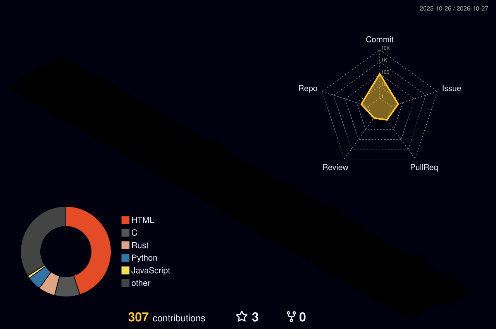

# Dominic Kolp

| https://domkolp.com | contact@domkolp.com | https://youtube.com/@stupidlilgoober0 | https://discord.com/user/1246426621641101363 |
| :---: | :---: | :---: | :---: |

  
About me

  

    I am a backend programmer. I primarily make stuff in Python, as it was one of the first languages I had
    learned. I also enjoy C, and I find enjoyment in learning new languages. I make tools that I <em>personally</em>
    think I would find useful.
    You can find more stuff about me on my <a href="https://domkolp.com">website</a>.
  

  
Stats

  

  
Discord Status

  

